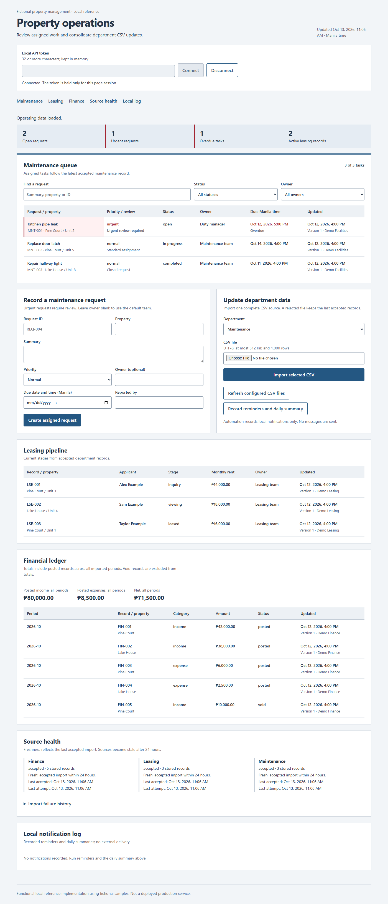
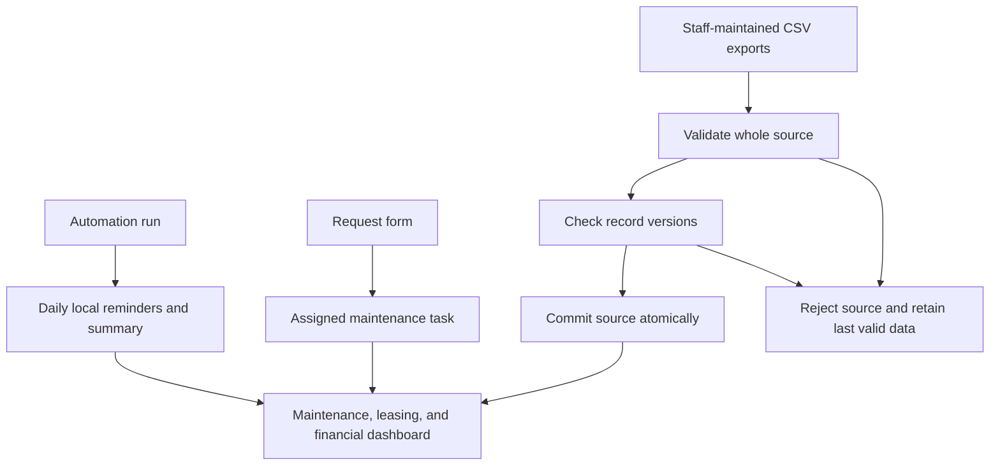

# Business Operations Dashboard

A local property-management reference that consolidates staff CSV updates, creates assigned maintenance tasks, and records overdue reminders and a daily operations summary.

**Status:** Fictional portfolio reference implementation. No connected accounts, external message delivery, or production deployment. Python 3.11+ runs the engine and web server without pip dependencies; the dashboard uses native HTML, CSS, and JavaScript.



## Run

```powershell
python -m unittest discover -v
python demo.py
$env:OPERATIONS_API_TOKEN = python -c "import secrets; print(secrets.token_urlsafe(32))"
python app.py serve --files samples
```

Open `http://127.0.0.1:8766`, enter the token from your shell, and choose **Refresh configured CSV files**. The server never prints the token; display it privately in the shell if needed. Production credentials are not needed for the demo. See [SETUP.md](SETUP.md) for staff file setup and scheduled workflow imports.

## How it works



1. Each department maintains its standard CSV. Shared fields identify the record, version, last edit time, and colleague who made it.
2. Refresh reads three fixed filenames from the configured folder. Each source is validated before any of its changes commit. A rejected source retains previous valid records; good sibling sources can still update.
3. New records start at version 1. Changes require exactly the next version. Same-version identical records are no-ops; stale, skipped, or conflicting revisions are rejected. A missing row never deletes a stored record.
4. Maintenance records derive one task each. Request intake assigns `Duty manager` for urgency or `Maintenance team` for normal work when no owner is supplied. The task follows accepted status, due-date, and owner revisions.
5. Automation records one overdue reminder per task, owner, and Manila day, plus one daily summary. Terminal tasks do not receive new reminders. These are durable **local log entries**, not emails or Slack messages.
6. Finance totals use integer centavos and include posted rows across all imported periods; void rows are excluded. Leasing shows its department's accepted stages.

## Dashboard actions

- Connect/disconnect with a memory-only local token; disconnect clears displayed records and token.
- Refresh configured files or upload one department CSV.
- Record a maintenance request with an assigned owner.
- Filter maintenance by text, status, or owner.
- Review source freshness, rejection details, and failure history.
- Record reminders/summary and inspect the local log.

Source freshness means the last accepted import, stale after 24 hours. Record update dates remain separate. Reimporting a file does not prove staff reviewed or changed every record.

## Project files

| File | Purpose |
| --- | --- |
| `engine.py` | Bounded CSV parsing, revision checks, SQLite records/source health, derived tasks, local notifications |
| `app.py` | Loopback server, token/host/origin checks, JSON API, and CLI commands |
| `static/` | Buildless dashboard with functional forms, tables, filters, and states |
| `samples/` | Fictional maintenance, leasing, and finance data |
| `templates/` | Exact CSV header templates; add records before import |
| `n8n-maintenance.json` | Inactive authenticated intake workflow |
| `n8n-refresh.json` | Inactive hourly refresh followed by automation only when all sources succeed |
| `demo.py` | Asserted walkthrough; writes ignored `output/demo-run.json` |
| `test_*.py` | Engine, real HTTP, and n8n expression/graph checks |
| [SOP.md](SOP.md) | Colleague workflow and conflict recovery |
| [Design](docs/superpowers/specs/2026-10-13-operations-design.md) | Scope, behavior, trade-offs, and limits |
| [Plan](docs/superpowers/plans/2026-10-13-operations.md) | Implementation sequence |
| [Verification](docs/VERIFICATION.md) | Observed checks and browser evidence |

## Limits

Single operator, shared local token, small CSV datasets. `updated_by` and `reported_by` are supplied audit labels, not authenticated staff identity. No user roles, file watcher, cloud spreadsheet connection, external notifications, accounting integration, AI inference, or deployed SaaS is claimed. Rules and exact arithmetic handle the demonstrated tasks without model calls.

CSV sources are independent transactions, not an all-department accounting snapshot. Imported history is retained; use terminal statuses for closure or voiding. Daily summaries retain their original generation snapshot even if records change later that day. Existing notification entries remain audit history after tasks close. Reassigned owners may receive a new same-day reminder.

Scheduled n8n rejects partial refresh before recording reminders; manual operators can still deliberately run automation against the last valid data. Engine/API tests and workflow-expression checks do not establish n8n runtime import or execution.

Verification recorded on 2026-10-13: 25 automated tests, the asserted offline demo, JavaScript syntax check, real desktop/mobile browser actions, and computed contrast passed. Detailed results and limits are in [the verification record](docs/VERIFICATION.md); [mobile screenshot](docs/screenshots/dashboard-mobile.png).
