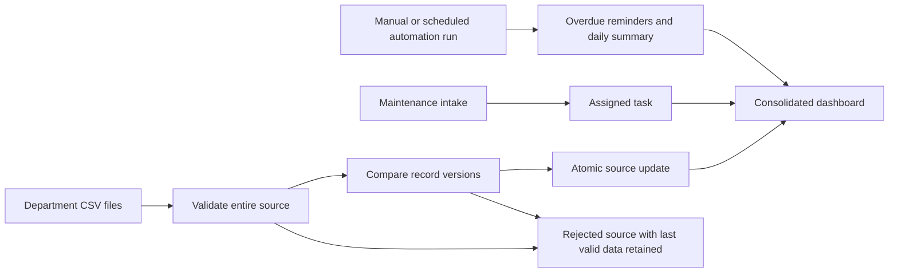

# Business Operations Dashboard Design

## Outcome and decisions

A local reference implementation for a fictional property-management company. Colleagues export standard maintenance, leasing, and finance CSV files; the dashboard validates and consolidates them. Maintenance intake creates assigned tasks. A repeatable automation run records overdue reminders and a daily operational summary.

The user requested the same Superpowers brainstorming, planning, implementation, and verification method as the lead-to-CRM project and selected CSV inputs. This authorizes the local build. Publishing to GitHub or hosting remains a separate action.

Selected approach: Python 3.11+ standard library, SQLite, buildless HTML/CSS/JavaScript, and optional n8n HTTP orchestration. Reuse the prior project's loopback API patterns, not a cross-repository import. Alternatives: spreadsheet-only reporting cannot demonstrate intake/recovery well; a BI/framework stack adds dependencies and account setup before a local demo exists.

## Scope and flow



Each source is atomic independently. A bad finance file does not prevent a good maintenance file from updating. Missing records never delete stored records; explicit terminal statuses are used instead. Missing files and header-only exports are rejected. All public fixtures are fictional; no real personal or financial data is committed.

## CSV contract

All three sources use `record_id`, `property`, `version`, `updated_at`, and `updated_by`. IDs use ASCII letters, digits, underscore, and hyphen; positive integer versions start at one. Timestamps must be timezone-aware ISO 8601 and not future dates. Text is bounded, enums exact, IDs unique within a file, UTF-8 BOM supported. Cap each CSV at 512 KiB and 1,000 rows.

| Source | Additional fields | Accepted values |
| --- | --- | --- |
| maintenance | `summary`, `priority`, `status`, `owner`, `due_at` | priority normal/urgent; status open/in_progress/completed/cancelled |
| leasing | `applicant`, `stage`, `monthly_rent_php`, `owner` | stage inquiry/viewing/application/leased/lost |
| finance | `period`, `category`, `amount_php`, `status` | period YYYY-MM; category income/expense; status posted/void |

Amounts are nonnegative plain decimal strings with at most two decimal places. Store integer centavos and expose `amount_cents`/`monthly_rent_cents`; never aggregate binary floating-point amounts. No payment processing or accounting advice.

Versions: new IDs require version 1. Identical content at the same version is a no-op. Changed content at the same version, stale versions, skipped versions, and regressing update timestamps reject the entire source. An accepted update requires exactly current version + 1. This makes conflicting staff edits visible rather than silently selecting the last writer. The operator resolves conflicts by comparing the stored record and resubmitting a deliberate revision.

## Task and automation behavior

Every maintenance record has one derived assigned task keyed by its record ID; task state, owner, due date, and urgency follow the latest accepted maintenance version. Intake may omit owner: urgent requests go to `Duty manager`, normal requests to `Maintenance team`; urgent tasks carry an explicit review flag. Direct intake is idempotent for the same ID and business fields and never overwrites existing CSV records.

Automation records at most one overdue reminder per open/in-progress task, owner, and Asia/Manila calendar day. It records one daily summary per day; summaries retain their generation time and count snapshot. Completed/cancelled tasks do not receive reminders. Notifications are durable local log entries only; no email or Slack delivery is claimed. Run automations manually, through the CLI, or through the inactive scheduled n8n export after deliberate activation.

## Dashboard and API contract

Engine interfaces: `Engine(db_path, clock=None)`, `import_csv(kind, csv_text)`, `refresh(folder)`, `create_request(payload)`, `run_automations()`, `snapshot()`. `clock` returns an aware datetime; default current UTC. API: GET `/api/state`; POST `/api/import` with `{kind,csv_text}`; `/api/refresh` with `{}` using a server-configured folder; `/api/maintenance` with request fields; `/api/automations` with `{}`.

Snapshot shape:

```json
{
  "generated_at":"ISO timestamp", "timezone":"Asia/Manila",
  "metrics":{"open_requests":0,"urgent_requests":0,"overdue_tasks":0,"active_leasing":0,"income_cents":0,"expense_cents":0,"net_cents":0},
  "maintenance":[], "tasks":[], "leasing":[], "finance":[],
  "sources":[{"kind":"maintenance","status":"never","last_success_at":null,"last_attempt_at":null,"error":null,"stale":true,"record_count":0}],
  "notifications":[], "failures":[]
}
```

Snapshot maintenance/task rows expose the CSV fields plus `urgent_review`, `overdue`, `amount_cents` or `monthly_rent_cents` where applicable. Notifications expose `id`, `kind` (`overdue_reminder` or `daily_summary`), `created_at`, `owner`, `record_id`, `message`, and `status: recorded`. Failures expose source kind, attempt timestamp, and a useful bounded error including row number/record ID when applicable. Source freshness means last accepted import, stale after 24 hours; record update timestamps remain visible. Finance totals include posted records across supplied periods; group by period in the financial table so the total scope is explicit.

Serve static `index.html`, `app.js`, `style.css` from fixed routes; static assets contain no private data or token. The JSON API requires a 32+ character bearer token on a loopback-only Python server. Enter the token in the browser; retain it in memory only, clear it on disconnect. Reject hostile origins/hosts, non-JSON bodies, invalid framing, oversized requests, arbitrary paths, and unsafe static paths. No public production authentication claim.

Frontend actions: connect/disconnect, refresh configured files, upload a selected department CSV, create a maintenance request, run automations, filter maintenance by status/owner/text, and navigate the maintenance/leasing/finance/data-health/notification sections. All actions reflect actual API results. Prevent untrusted text from becoming HTML. Provide loading, disconnected, empty, rejection, and success states.

## Visual direction

Reading this as a staff operations dashboard, in a quiet administrative style, ENERGY 1 / RHYTHM 2 / MOTION 1. System sans-serif for legibility on staff machines; dark slate text on a cool light background; restrained blue action accent. Urgent work uses a red label plus text. Primary emphasis is the maintenance queue, with compact leasing/finance summaries and source health alongside it. Narrow screens stack sections and scroll tables within labeled containers. Native controls, visible focus, 44px action targets, computed text contrast, no decorative icons, imagery, gradients, or marketing claims.

## Deliverables and verification

Separate repository; design and plan; engine/API/frontend; fictional CSV fixtures and blank-header templates; two inactive n8n exports for maintenance intake and scheduled refresh/automations; tests; asserted offline demo; browser screenshots and a recorded click-through result; README, setup guide, and colleague SOP.

Tests cover all-or-nothing source imports, repeated imports, exact money sums, version conflicts, missing/malformed CSVs, maintenance assignment, idempotent intake, state changes after staff edits, overdue logic, Manila day deduplication, preserved records on refresh failure, API auth/framing/origin boundaries, and real frontend interactions. Browser-check desktop, narrow screen, keyboard focus, empty/error/loading states, and hostile text. n8n structure/expression checks are separate from runtime import/execution.

## Limits

Single-operator local reference, not deployed SaaS. One shared API token, no per-person authorization. CSV `updated_by` is an audit label, not authenticated identity. Import thresholds favor small business datasets; no watcher, cloud files, accounting synchronization, external notifications, or AI inference in this version. Rules and exact totals already solve these tasks; an LLM would need a specific later use case. SQLite serializes writes; move to a server database and leased jobs before concurrent workers. Keep operating data ignored.
